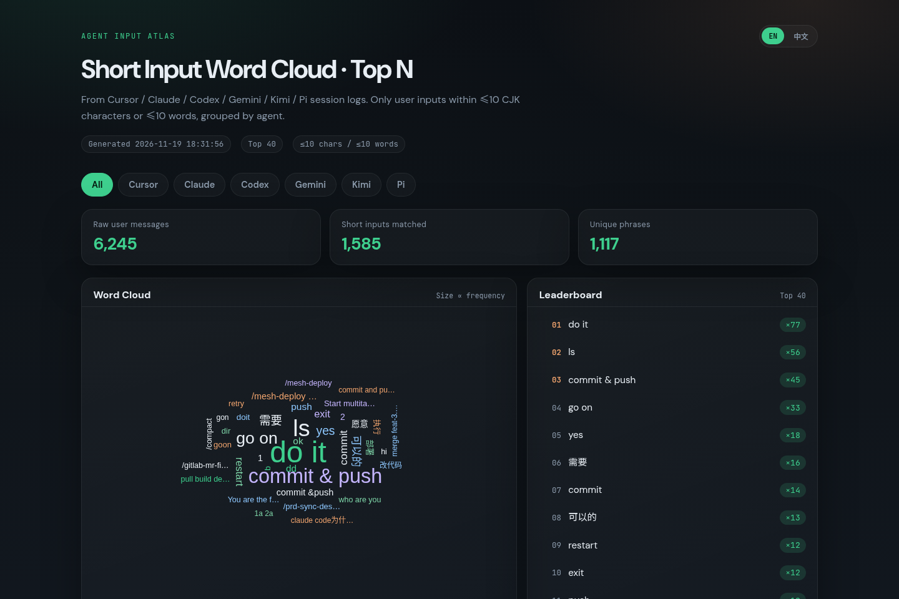
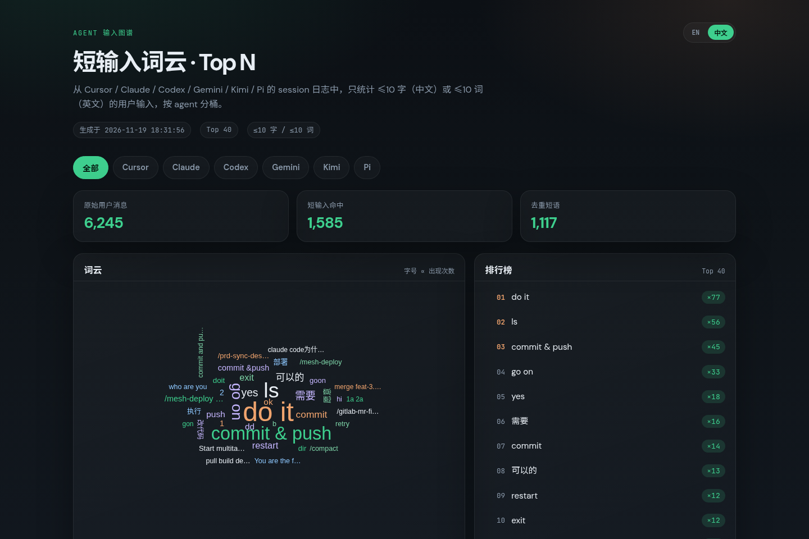

# Agent Input Atlas

[English](README.md) | [中文](README.zh-CN.md)

Turn your AI coding-agent session logs into a local **short-input word cloud** and **Top N** leaderboard.

Parses user messages from **Cursor / Claude / Codex / Gemini / Kimi / Pi**, keeps only short prompts (≤10 CJK chars or ≤10 words by default), and writes a self-contained HTML report with agent tabs and EN/中文 UI.



<p align="center"><em>English UI · language switch in the top-right</em></p>



<p align="center"><em>Chinese UI · same data, localized labels</em></p>

## Features

- **Multi-agent**: Cursor, Claude Code, Codex (`xcode` alias), Gemini, Kimi, Pi
- **Short-input filter**: CJK-heavy text by character count; otherwise by word count
- **Word cloud + Top N**: frequency-weighted cloud and ranked phrase list
- **Per-agent tabs**: inspect All / each agent separately
- **i18n page**: EN / 中文, defaults to the browser language, remembers the choice
- **Local only**: no network upload; HTML is generated on your machine

## Requirements

- Python 3.8+
- Standard library only (no `pip install`)

## Quick start

```bash
git clone https://github.com/deliangyang/agent-input-atlas.git
cd agent-input-atlas

python3 generate_stats.py
```

Open the generated file:

```text
output/wordcloud.html
```

## CLI

```bash
python3 generate_stats.py
python3 generate_stats.py --top 50 --max-chars 10 --max-words 10
python3 generate_stats.py --agents cursor,claude,codex
python3 generate_stats.py --agents xcode,cursor   # xcode -> codex
python3 generate_stats.py --output output/stats.html -v
```

| Flag | Default | Description |
|------|---------|-------------|
| `--top` | `40` | Top N phrases per agent (and All) |
| `--max-chars` | `10` | Max length for CJK-heavy inputs |
| `--max-words` | `10` | Max words for non-CJK inputs |
| `--agents` | `cursor,claude,codex,gemini,kimi,pi` | Agents to scan |
| `--output` | `output/wordcloud.html` | Output HTML path |
| `--min-count` | `1` | Minimum frequency to include |
| `-v` / `--verbose` | off | Verbose logs |

## Data sources

| Agent | Default path |
|-------|----------------|
| Cursor | `~/.cursor/projects/**/agent-transcripts/*.jsonl` |
| Claude | `~/.claude/projects/**/*.jsonl` |
| Codex | `~/.codex/sessions/**/*.jsonl` |
| Gemini | `~/.gemini/tmp/**/session-*.json` |
| Kimi | `~/.kimi-code/user-history` (+ session wires) |
| Pi | `~/.pi/agent/sessions/**/*.jsonl` |

Noise such as IDE system wrappers, tool results, and synthetic Cursor diff-tab actions is filtered out.

## Page language

The report UI ships with **English** and **Chinese**:

- Default follows `navigator.language` (`zh*` → Chinese, otherwise English)
- Manual toggle in the top-right corner
- Choice is stored in `localStorage`

## Privacy

- Reads only local session logs under your home directory
- Writes a local HTML file under `output/` (gitignored)
- Does not send data anywhere

## License

MIT
