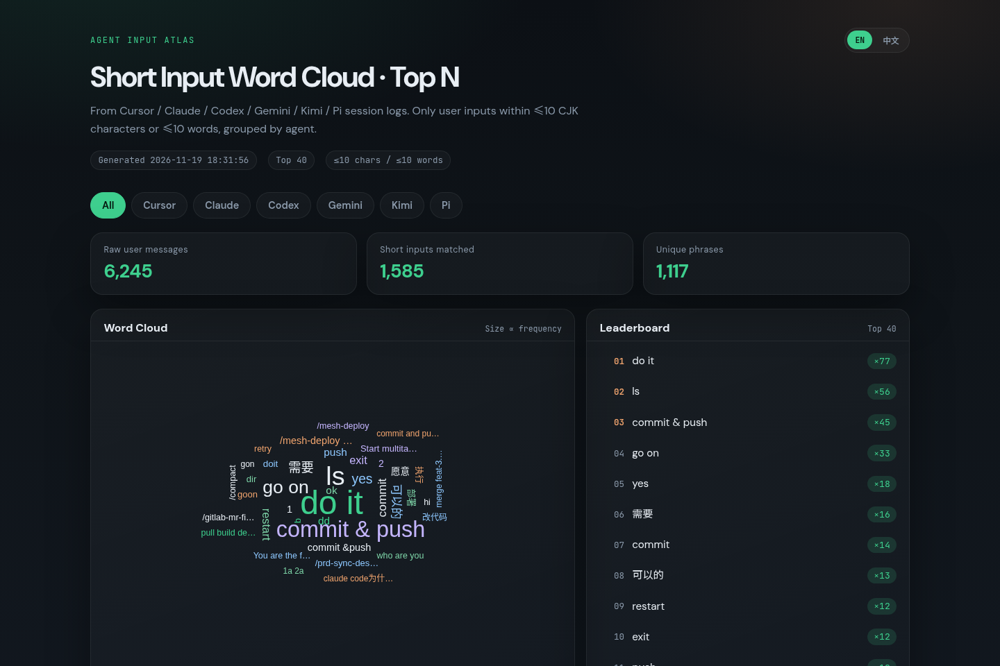
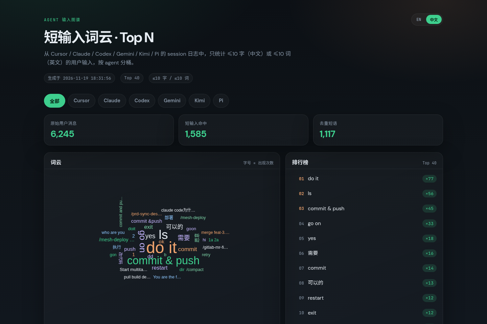

# Agent Input Atlas

[English](README.md) | [中文](README.zh-CN.md)

把各 AI 编程 Agent 的 session 日志，生成本地 **短输入词云** 与 **Top N** 排行榜。

支持解析 **Cursor / Claude / Codex / Gemini / Kimi / Pi** 的用户输入，只保留短指令（默认 ≤10 个汉字或 ≤10 个英文单词），输出带 Agent 分栏、EN/中文切换的单文件 HTML 报告。



<p align="center"><em>英文界面 · 右上角可切换语言</em></p>



<p align="center"><em>中文界面 · 同一份数据，文案本地化</em></p>

## 功能

- **多 Agent**：Cursor、Claude Code、Codex（别名 `xcode`）、Gemini、Kimi、Pi
- **短输入过滤**：偏中文按字数，否则按单词数
- **词云 + Top N**：按出现次数展示云图与排行榜
- **按 Agent 分栏**：全部 / 各 Agent 单独查看
- **双语页面**：EN / 中文，默认跟随浏览器语言并记住选择
- **纯本地**：不上传；HTML 在本机生成

## 环境要求

- Python 3.8+
- 仅标准库（无需 `pip install`）

## 快速开始

```bash
git clone https://github.com/deliangyang/agent-input-atlas.git
cd agent-input-atlas

python3 generate_stats.py
```

打开生成文件：

```text
output/wordcloud.html
```

## 命令行

```bash
python3 generate_stats.py
python3 generate_stats.py --top 50 --max-chars 10 --max-words 10
python3 generate_stats.py --agents cursor,claude,codex
python3 generate_stats.py --agents xcode,cursor   # xcode -> codex
python3 generate_stats.py --output output/stats.html -v
```

| 参数 | 默认值 | 说明 |
|------|--------|------|
| `--top` | `40` | 每个 Agent（及全部）的 Top N |
| `--max-chars` | `10` | 偏中文输入的最大字数 |
| `--max-words` | `10` | 非中文输入的最大单词数 |
| `--agents` | `cursor,claude,codex,gemini,kimi,pi` | 要扫描的 Agent |
| `--output` | `output/wordcloud.html` | 输出 HTML 路径 |
| `--min-count` | `1` | 纳入统计的最低出现次数 |
| `-v` / `--verbose` | 关闭 | 详细日志 |

## 数据来源

| Agent | 默认路径 |
|-------|----------|
| Cursor | `~/.cursor/projects/**/agent-transcripts/*.jsonl` |
| Claude | `~/.claude/projects/**/*.jsonl` |
| Codex | `~/.codex/sessions/**/*.jsonl` |
| Gemini | `~/.gemini/tmp/**/session-*.json` |
| Kimi | `~/.kimi-code/user-history`（及 session wire） |
| Pi | `~/.pi/agent/sessions/**/*.jsonl` |

会过滤 IDE 系统包装、工具结果、Cursor 合成的 diff-tab 动作等噪音。

## 页面语言

报告页内置 **英文** 与 **中文**：

- 默认跟随 `navigator.language`（`zh*` → 中文，否则英文）
- 右上角可手动切换
- 选择会写入 `localStorage`

## 隐私

- 只读取本机 home 目录下的 session 日志
- 输出到本地 `output/`（已被 gitignore）
- 不会向外部发送数据

## License

MIT
